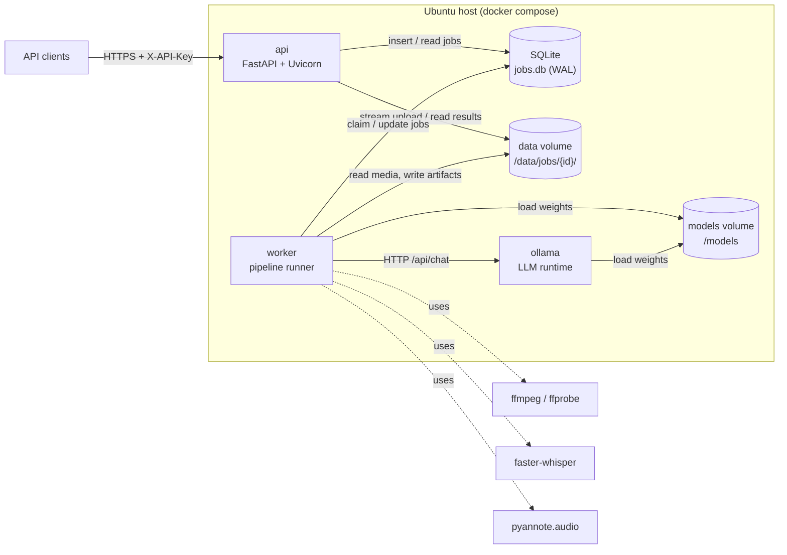
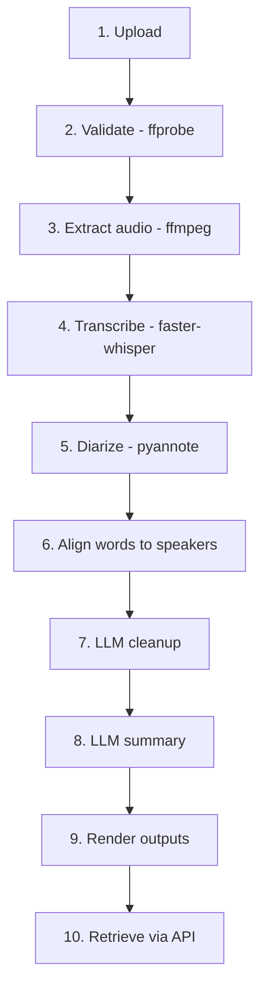
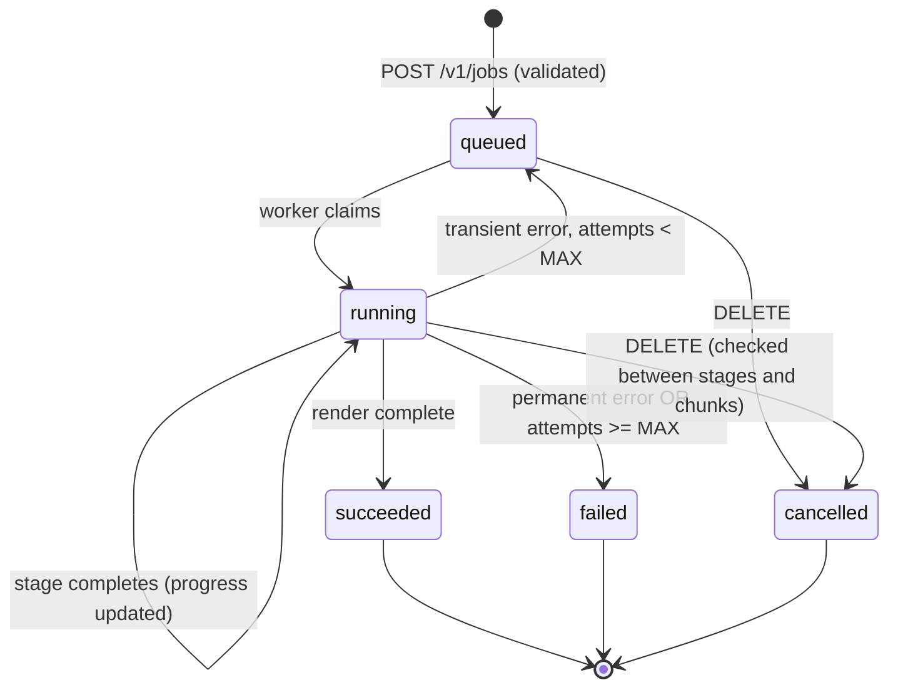

# Local Video Transcription Service: Architecture

**Status:** Approved · **Version:** 1.1 · **Date:** 2026-10-17

> 1.1: retention default changed to 2 days; FFmpeg distro build accepted (§15 open questions resolved).

---

## 1. Overview & scope

The service accepts video files over an HTTP API. For each file it extracts the audio and transcribes it with a local Whisper-family model. It then labels speakers with a local diarization model and cleans up and summarizes the transcript with a local LLM. Results come back as JSON, plain text, SRT, VTT, and a Markdown summary. Once the models are downloaded, nothing leaves the host.

### Goals

- Transcribe English speech from MP4, MKV, MOV, and AVI files of up to 4 hours (typical: 1 hour).
- Label speakers (`SPEAKER_00`, `SPEAKER_01`, …) at the word level, then group words into speaker turns.
- Run LLM post-processing for punctuation and formatting, corrections of obvious mis-recognitions, and a summary.
- Run on NVIDIA GPU, Apple Silicon, or CPU-only machines with no code changes, selecting backends and model sizes automatically.
- Handle 5 concurrent API users and about 5 videos per day with headroom.
- Ship as one Python codebase with two entry points (API and worker) plus an Ollama container, using only permissively licensed dependencies.

### Non-goals (v1)

- Real-time or streaming transcription.
- Languages other than English. The model choice keeps a path open for later; see §15.
- Speaker *identification*: names are not attached to voices. Labels are anonymous.
- Multi-node scaling, per-user accounts, or a web UI.
- Translation.

---

## 2. Components



| Component | Responsibility |
|---|---|
| **api** | Authenticates requests, validates and streams uploads to disk, creates jobs, and serves status and results. Holds no ML models, so it starts fast and stays small. |
| **worker** | Claims queued jobs from SQLite and runs the pipeline stages one after another. Owns all ASR and diarization models and is the only process that touches the GPU (besides Ollama). |
| **SQLite (`jobs.db`)** | Job queue and metadata store. WAL mode allows concurrent reads by the API while the worker writes. |
| **data volume** | One directory per job holding the source video, the extracted audio, every intermediate artifact, and the final outputs. |
| **models volume** | Whisper CTranslate2 weights, the pyannote pipeline, and Ollama model blobs. Populated once by `make models`, then mounted read-only into the worker. |
| **ollama** | Serves the post-processing LLM over its local HTTP API. Runs as a separate container because it is a separate binary with its own GPU management. It is a runtime dependency, not a microservice we write. |

---

## 3. Processing pipeline



Each stage reads the previous stage's artifact from the job directory and writes its own. A stage is complete only when its output file has been written atomically (written to `*.tmp`, then `os.replace`). On retry, the worker skips any stage whose artifact already exists (see §6).

| # | Stage | Input | Output artifact | Notes |
|---|---|---|---|---|
| 1 | Upload (api) | multipart stream | `source.<ext>` | Streamed to disk in 1 MiB chunks, never held in memory. Size limit enforced while streaming. |
| 2 | Validate (api) | `source.<ext>` | `probe.json` | `ffprobe -show_format -show_streams -of json`. Rejects the upload if the container is not in the allow-list, there is no audio stream, or duration > `MAX_DURATION_S`. Runs synchronously before returning 202, so bad files fail fast. |
| 3 | Extract | `source.<ext>` | `audio.wav` | `ffmpeg -nostdin -i source -map 0:a:0 -vn -ac 1 -ar 16000 -c:a pcm_s16le audio.wav`. Uses the first audio track; 16 kHz mono PCM is the native input for both Whisper and pyannote. A 1-hour file is about 115 MB. |
| 4 | Transcribe | `audio.wav` | `asr.json` | faster-whisper with `word_timestamps=True`, `vad_filter=True`, `language="en"`. Uses `BatchedInferencePipeline` on CUDA, sequential `WhisperModel.transcribe` on CPU. Output: segments with words, each word with `start`, `end`, `probability`. |
| 5 | Diarize | `audio.wav` | `diarization.json` | pyannote `speaker-diarization-community-1`. Audio is passed as an in-memory waveform tensor (`{"waveform", "sample_rate"}`), so pyannote's own decoder is not used. The worker keeps the **exclusive** diarization (one speaker at a time), which maps cleanly onto words. Optional `num_speakers` / `min_speakers` / `max_speakers` hints come from the request. |
| 6 | Align | `asr.json`, `diarization.json` | `aligned.json` | Each word goes to the speaker turn with the greatest temporal overlap. A word with no overlap goes to the nearest turn within 0.5 s, otherwise to the previous word's speaker. Consecutive words with the same speaker are grouped into **utterances**, and an utterance is split at a gap > 1.5 s or a length > 60 s. |
| 7 | Cleanup (LLM) | `aligned.json` | `cleaned.json` | Optional (default on). Rewrites utterance text for punctuation, casing, and obvious mis-recognitions while keeping utterance IDs and boundaries. Chunked per §6.4. Guarded against over-editing. |
| 8 | Summary (LLM) | `cleaned.json` | `summary.md` | Optional (default on). Map-reduce summarization, per §6.4. |
| 9 | Render | `cleaned.json`, `summary.md` | `transcript.json`, `.txt`, `.srt`, `.vtt` | Deterministic, no models. Formats are defined in §8. |
| 10 | Retrieve (api) | rendered files | HTTP response | Files are served from disk with the correct `Content-Type`. |

**Why align at the word level?** Whisper segment boundaries do not line up with speaker changes. Assigning whole segments to speakers mislabels the first and last words of most turns. Word-level assignment using exclusive diarization fixes this cheaply and needs no extra alignment model.

**Why does cleanup keep the original timestamps?** The LLM only edits text inside an utterance. Utterance start and end times come from the ASR words and never change. Word-level timings in `transcript.json` remain the raw ASR words, and the cleaned text lives in each utterance's `text` field. Subtitles use utterance timings.

---

## 4. Technology choices

| Concern | Choice (target version) | License | Alternatives considered | Justification |
|---|---|---|---|---|
| Language/runtime | Python 3.11 | PSF | 3.12 | Required ≥3.11. 3.11 has the broadest wheel coverage across torch, CTranslate2, and pyannote. |
| API framework | FastAPI ≥0.115 + Uvicorn | MIT / BSD-3 | Flask, Litestar | Native async streaming uploads, Pydantic v2 schemas, and auto-generated OpenAPI docs. |
| Validation/settings | Pydantic v2 + pydantic-settings | MIT | dataclasses + env parsing | Typed config loaded from env, shared with API schemas. |
| Job queue | SQLite (stdlib `sqlite3`, WAL) with a polling worker | Public domain | Redis + RQ, Celery | At 5 jobs/day a broker adds an extra service and a failure mode for no benefit. SQLite gives durable state, atomic claims, and zero ops. |
| Media tooling | FFmpeg 6.x (`ffmpeg`, `ffprobe` CLI) | LGPL/GPL (see §15) | PyAV only | The CLI is the most robust decoder for MKV/AVI edge cases, and it runs as a subprocess with no linking. |
| ASR | faster-whisper 1.2.1 (CTranslate2 4.x) | MIT | whisper.cpp, openai-whisper, WhisperX | About 4× faster than openai-whisper at the same accuracy, int8 quantization, batched GPU inference, built-in Silero VAD, and word timestamps. One library covers both CUDA and CPU. |
| ASR weights | `large-v3`, `large-v3-turbo`, `distil-large-v3` (CTranslate2 conversions) | MIT | `medium.en` | Selected per hardware tier (§5). `distil-large-v3` is English-only and well suited to CPU. |
| Diarization | pyannote.audio 4.0.7 | MIT (code) | NVIDIA NeMo, WhisperX diarize | Best open-source diarization accuracy, and the exclusive mode simplifies word alignment. NeMo is heavier and CUDA-centric. |
| Diarization weights | `pyannote/speaker-diarization-community-1` | **CC-BY-4.0** | `speaker-diarization-3.1` | Better than 3.1 across benchmarks. CC-BY-4.0 permits commercial use **with attribution**: credit it in README/NOTICE. Download is gated on Hugging Face (one-time token, see §13). |
| Deep-learning runtime | PyTorch 2.x (the version required by pyannote.audio 4.0.7) | BSD-3 | — | Required by pyannote. Also used for CUDA/MPS detection. |
| LLM runtime | Ollama (pinned image tag) | MIT | llama.cpp server, vLLM | Simple model management, a stable HTTP API, and Metal on macOS plus CUDA on Linux with no work on our side. vLLM is CUDA-only and heavy. |
| Default LLM | `qwen3:8b` (Qwen3-8B) | Apache 2.0 | Llama 3.1 8B (Llama Community License, not permissive), Mistral 7B (Apache 2.0) | Permissive license, a 32K native context, and strong instruction following at 8B. Llama remains selectable through `LLM_MODEL`. |
| LLM client | httpx ≥0.27 | BSD-3 | `ollama` Python SDK | One small dependency with explicit timeouts and retries, and no coupling to SDK release cadence. |
| Metrics | prometheus-client | Apache 2.0 | OpenTelemetry | Single process pair; a `/metrics` endpoint is enough. |
| Logging | stdlib `logging` + python-json-logger | BSD-2 | structlog | JSON logs with no new paradigm. |
| Packaging | `uv` + `pyproject.toml`, lockfile committed | MIT/Apache | pip-tools, Poetry | Fast reproducible installs, and it can provision Python 3.11 inside CUDA base images. |
| Testing | pytest, pytest-asyncio, httpx `TestClient` | MIT | — | Standard tooling. |

All third-party licenses are recorded in `NOTICE` and checked in CI with `pip-licenses --fail-on` (GPL, AGPL, LGPL, and non-commercial licenses fail the build; FFmpeg is a system binary, outside the Python graph).

---

## 5. Hardware detection & backend selection

Detection runs once when the worker starts. The result is logged, exposed at `GET /v1/system`, and cached as a `HardwareProfile`. The API never loads models and does not run detection.

### 5.1 Detection logic

```
profile = HardwareProfile()
if DEVICE != "auto":                         # explicit override wins
    profile.device = DEVICE
elif torch.cuda.is_available() and ctranslate2.get_cuda_device_count() > 0:
    profile.device = "cuda"
    profile.vram_gb = torch.cuda.get_device_properties(0).total_memory / 2**30
elif sys.platform == "darwin" and platform.machine() == "arm64" \
        and torch.backends.mps.is_available():
    profile.device = "apple"
else:
    profile.device = "cpu"
profile.cpu_threads = min(os.cpu_count(), CPU_THREADS or os.cpu_count())
profile.tier = select_tier(profile)          # table 5.2
```

CUDA requires both checks: torch can see a GPU while CTranslate2 lacks matching cuDNN libraries. If either check fails, the profile falls through to CPU and logs a warning that names the missing check.

### 5.2 Tiers and default models

| Tier | Condition | ASR model / compute type / device | ASR batching | Diarization device | Default LLM | LLM `num_ctx` |
|---|---|---|---|---|---|---|
| `cuda-large` | CUDA, VRAM ≥ 16 GB | `large-v3` / `float16` / cuda | batch 16 | cuda | `qwen3:8b` | 16384 |
| `cuda-medium` | CUDA, 8 ≤ VRAM < 16 GB | `large-v3-turbo` / `int8_float16` / cuda | batch 8 | cuda | `qwen3:8b` | 8192 |
| `cuda-small` | CUDA, VRAM < 8 GB | `distil-large-v3` / `int8_float16` / cuda | batch 4 | cuda | `qwen3:4b` | 8192 |
| `apple` | Apple Silicon (native macOS only) | `distil-large-v3` / `int8` / **cpu** | none | mps | `qwen3:8b` | 8192 |
| `cpu` | Fallback | `distil-large-v3` / `int8` / cpu | none | cpu | `qwen3:4b` | 8192 |

On the `apple` tier, the ASR runs on CPU because CTranslate2 has no Metal backend. Diarization still uses MPS, and Ollama uses Metal natively. Docker on macOS cannot reach Metal, which is why §13 runs macOS development natively.

**GPU memory sharing.** The worker and Ollama share one GPU. The worker releases the ASR model after stage 4 and the diarization pipeline after stage 5 (`del` plus `torch.cuda.empty_cache()`) before calling the LLM, and it requests `keep_alive: "5m"` from Ollama. Peak usage is therefore the larger of ASR+diarization or the LLM, never all three. A model-load cost of a few seconds per job is negligible at 5 jobs/day.

**Expected wall-clock time for a 1-hour file** (planning estimates, verify in §12 benchmarks): `cuda-large` 4–7 min; `cuda-medium` 6–10 min; `apple` (M-series) 20–35 min; `cpu` (8+ cores) 60–120 min, dominated by the ASR and LLM stages.

### 5.3 Runtime fallback

If a model fails to load or hits an out-of-memory error at inference:

1. On CUDA with `float16`, retry the stage with `int8_float16`.
2. Still failing: retry on the next smaller ASR model in the tier chain (`large-v3` → `large-v3-turbo` → `distil-large-v3`).
3. Still failing: move the stage to CPU with `int8`.

Each step is logged at WARNING with the reason and recorded in the job's `warnings` array, so clients can see degraded quality. Fallback runs per job; the profile is not permanently downgraded.

### 5.4 Overrides

Every tier default can be overridden: `DEVICE`, `ASR_MODEL`, `ASR_COMPUTE_TYPE`, `ASR_BATCH_SIZE`, `DIARIZATION_DEVICE`, `LLM_MODEL`, `LLM_NUM_CTX` (§9). An override always takes precedence over the tier, and the effective settings are written into each job's `meta.json` for reproducibility.

---

## 6. Job handling

### 6.1 Queue

- The `jobs` table is the queue. The worker claims the oldest queued job with a single atomic statement:
  `UPDATE jobs SET status='running', claimed_at=now, worker_id=? WHERE id = (SELECT id FROM jobs WHERE status='queued' ORDER BY created_at LIMIT 1) RETURNING *`.
- The worker polls every `WORKER_POLL_INTERVAL_S` (default 2 s) when idle, which is ample at this load.
- **Concurrency: one job at a time per worker** (`WORKER_CONCURRENCY=1`). A single GPU is saturated by one 1-hour job, and parallel jobs would only add VRAM contention. Five concurrent users each submitting a file get FIFO processing. Queue position is reported in the job status.
- **Crash recovery:** at startup, the worker resets any `running` job whose `heartbeat_at` is more than 5 minutes old to `queued` and increments its `attempts`. While running, the worker updates `heartbeat_at` every 15 s.

### 6.2 State machine



`stage` (one of `extracting`, `transcribing`, `diarizing`, `aligning`, `cleaning`, `summarizing`, `rendering`) and `progress` (0.0–1.0) are separate fields from `status`. Progress uses fixed stage weights (extract 0.05, transcribe 0.45, diarize 0.20, align 0.02, cleanup 0.18, summary 0.08, render 0.02). Within transcription and LLM stages, progress is interpolated from audio seconds processed or chunks completed.

### 6.3 Long audio

There is no manual audio chunking. faster-whisper streams through the file in 30-second windows, with VAD segmenting speech, so a 4-hour file uses memory independent of length for ASR. pyannote processes the full waveform: a 4-hour file at 16 kHz float32 is about 920 MB of RAM, within budget for the target server (minimum 16 GB RAM, §13). If `duration > 4 h`, validation rejects the file.

### 6.4 LLM chunking and merge

A 1-hour meeting yields about 9,000–10,000 words (about 13,000 tokens), which is larger than the safe input budget. All LLM calls therefore work on chunks sized by a token **estimate** (`ceil(chars / 3.5)`, deliberately conservative for English), with the budget derived from the context window:

```
input_budget = LLM_NUM_CTX
             - prompt_overhead_tokens (measured system+instruction tokens, ~400)
             - expected_output_tokens (≈ input size for cleanup; 600 for map summaries)
             - safety_margin (10%)
```

For `num_ctx=8192` this gives about 3,300 input tokens for cleanup and about 5,800 for summary maps.

**Cleanup (stage 7):**
1. Pack whole utterances greedily into chunks up to `input_budget`. An utterance is never split. An utterance larger than the budget, which is rare since utterances cap at 60 s, is sent alone.
2. Each request carries a JSON array `[{"id": "u_0042", "speaker": "SPEAKER_01", "text": "..."}]`, plus up to 2 preceding utterances marked `"context_only": true` for continuity.
3. The model must return the same IDs with edited `text`, using Ollama's structured output (`format`: JSON schema) at `temperature: 0`. Qwen3's reasoning mode is disabled (`think: false`) so the token budget goes to output.
4. **Merge and guard:** results are mapped back by ID. For each utterance, the worker computes the word-level edit ratio between original and cleaned text. If it exceeds `LLM_MAX_EDIT_RATIO` (default 0.25), or an ID is missing or added, the original text is kept and a warning is recorded. This bounds hallucination: the LLM can polish text but cannot rewrite or invent content.
5. Chunk failures (timeout or invalid JSON after one retry) keep the original text for that chunk; the stage still succeeds, with a warning.

**Summary (stage 8): map-reduce.**
1. *Map:* split cleaned utterances into chunks of up to `input_budget` and ask for a bullet summary of each (≤ 200 words), noting speakers and decisions.
2. *Reduce:* concatenate map outputs. If they exceed `input_budget`, reduce them recursively in groups. A 1-hour file normally needs 3–4 maps and one reduce.
3. The final prompt produces a fixed Markdown structure: **Overview** (3–5 sentences), **Key points**, **Decisions**, **Action items** (with speaker labels when stated), and **Topics** with approximate timestamps taken from chunk start times.

### 6.5 Retries

| Error class | Examples | Handling |
|---|---|---|
| Transient | Ollama connection refused, LLM timeout, CUDA OOM after fallback chain, disk temporarily full | Job back to `queued` with exponential delay (`not_before = now + 30 s × 2^attempts`). Max `JOB_MAX_ATTEMPTS` = 3. Completed stage artifacts are reused, so retries resume rather than restart. |
| Permanent | Corrupt media, no audio stream, missing model files, invalid config | `failed` immediately with an error code (§7.3). |
| LLM chunk-level | Bad JSON or guard rejection | Handled inside the stage (§6.4), never fails the job. |

If Ollama is unreachable after all retries, the job **succeeds without post-processing**: raw aligned text is rendered, `cleanup_applied=false` and `summary=null` are set, and a warning is added. A transcript is more valuable than a failure.

---

## 7. API specification

Base path `/v1`. JSON responses only, except for transcript downloads. Every endpoint except `/healthz`, `/readyz`, and `/metrics` requires the `X-API-Key` header. Interactive OpenAPI docs are at `/docs` (they require auth when `DOCS_ENABLED=true`, default false in production).

### 7.1 Endpoints

**`POST /v1/jobs`**: submit a video. `Content-Type: multipart/form-data`.

| Field | Type | Required | Default |
|---|---|---|---|
| `file` | binary | yes | — |
| `num_speakers` | int 1–20 | no | null |
| `min_speakers` / `max_speakers` | int 1–20 | no | null |
| `cleanup` | bool | no | `true` |
| `summary` | bool | no | `true` |
| `title` | string ≤ 200 | no | original filename |

Response **202**:
```json
{ "id": "01JAB3K9ZQ4W1X8T6M2N5P7R0S", "status": "queued", "queue_position": 2,
  "created_at": "2026-10-17T18:12:03Z", "links": { "self": "/v1/jobs/01JAB3K9ZQ4W1X8T6M2N5P7R0S" } }
```
Errors: 400 `invalid_options`, 401, 413 `file_too_large`, 415 `unsupported_media`, 422 `no_audio_stream` / `duration_exceeded` / `unreadable_media`, 503 `queue_full` (when queued jobs ≥ `MAX_QUEUED_JOBS`, default 50).

**`GET /v1/jobs`**: list jobs, newest first. Query: `status`, `limit` (1–100, default 20), `cursor`. **200**: `{ "items": [Job], "next_cursor": "..." | null }`.

**`GET /v1/jobs/{id}`**: **200** returns the job resource:
```json
{
  "id": "01JAB3...", "title": "weekly-sync.mp4", "status": "running",
  "stage": "diarizing", "progress": 0.56, "queue_position": null,
  "options": { "num_speakers": null, "min_speakers": null, "max_speakers": null, "cleanup": true, "summary": true },
  "media": { "container": "mov,mp4,m4a,3gp,3g2,mj2", "duration_s": 3612.4, "size_bytes": 812349120 },
  "result": null,
  "warnings": [],
  "error": null,
  "attempts": 1,
  "created_at": "...", "started_at": "...", "finished_at": null
}
```
When `succeeded`, `result` is `{ "speakers": 3, "words": 9412, "cleanup_applied": true, "summary_available": true, "formats": ["json","txt","srt","vtt"], "models": {"asr": "large-v3", "diarization": "community-1", "llm": "qwen3:8b"} }`. When `failed`, `error` is an error object (§7.3). Errors: 401, 404.

**`GET /v1/jobs/{id}/transcript?format=json|txt|srt|vtt`** (default `json`): **200** with `application/json`, `text/plain; charset=utf-8`, `application/x-subrip`, or `text/vtt`, and `Content-Disposition: attachment; filename="<title>.<ext>"`. Errors: 404, 409 `job_not_ready` (status ≠ succeeded).

**`GET /v1/jobs/{id}/summary`**: **200** `text/markdown`. Errors: 404, 409 `job_not_ready`, 404 `summary_not_available` (disabled or LLM unavailable).

**`DELETE /v1/jobs/{id}`**: cancels a queued or running job and deletes all of its files. **204**. A running job stops at the next stage or chunk boundary; the worker checks a `cancel_requested` flag. Errors: 404.

**`GET /v1/system`**: **200**: `{ "version": "1.0.0", "hardware": {"device": "cuda", "tier": "cuda-medium", "gpu": "NVIDIA RTX 4070", "vram_gb": 12.0}, "models": {...effective settings}, "worker": {"alive": true, "last_heartbeat": "..."}, "queue": {"queued": 1, "running": 1} }`. The worker writes its profile to a `system` table at startup, and the API reads it from there.

**`GET /healthz`**: liveness, 200 `{"status":"ok"}` if the process is serving.
**`GET /readyz`**: readiness, 200 only if the DB is writable, the data volume has ≥ `MIN_FREE_DISK_GB` free, and a worker heartbeat is < 60 s old. Otherwise 503 with failing checks listed. Ollama health is reported but does not fail readiness, because jobs degrade gracefully without it.
**`GET /metrics`**: Prometheus text format (§11).

### 7.2 Identifiers

Job IDs are ULIDs: sortable, URL-safe, and not guessable in sequence.

### 7.3 Error format

Every non-2xx response uses:
```json
{ "error": { "code": "unsupported_media", "message": "Container 'flv' is not supported. Allowed: mp4, mkv, mov, avi.", "details": { "detected": "flv" } } }
```

| Code | HTTP | Meaning |
|---|---|---|
| `unauthorized` | 401 | Missing or invalid API key |
| `not_found` | 404 | Unknown job ID |
| `invalid_options` | 400 | Bad form fields (e.g. `min_speakers > max_speakers`) |
| `file_too_large` | 413 | Exceeds `MAX_UPLOAD_MB` |
| `unsupported_media` | 415 | Container not in allow-list |
| `no_audio_stream` / `duration_exceeded` / `unreadable_media` | 422 | Validation failures |
| `job_not_ready` | 409 | Results requested before success |
| `queue_full` | 503 | Back-pressure |
| `internal_error` | 500 | Unexpected; message is generic, details in server logs with the request ID |

Failed-job error codes (in `job.error.code`): `extraction_failed`, `transcription_failed`, `diarization_failed`, `model_unavailable`, `out_of_resources`, `cancelled`.

---

## 8. Data model & output formats

### 8.1 Database (SQLite)

`jobs`: `id TEXT PK`, `title TEXT`, `status TEXT`, `stage TEXT NULL`, `progress REAL`, `options JSON`, `media JSON`, `result JSON NULL`, `warnings JSON`, `error JSON NULL`, `attempts INT`, `cancel_requested INT`, `not_before TEXT NULL`, `worker_id TEXT NULL`, `heartbeat_at TEXT NULL`, `created_at`, `started_at`, `finished_at` (ISO-8601 UTC). Indexes: `(status, created_at)`.
`system`: `key TEXT PK`, `value JSON`, `updated_at`. Holds the worker profile and heartbeat.

Schema migrations are numbered SQL files applied at startup and tracked in `PRAGMA user_version`.

### 8.2 Job directory

```
/data/jobs/{id}/
  source.mp4  probe.json  audio.wav  asr.json  diarization.json  aligned.json
  cleaned.json  summary.md  meta.json
  out/transcript.json  out/transcript.txt  out/transcript.srt  out/transcript.vtt
```
`source.*` and `audio.wav` are deleted after success when `KEEP_MEDIA=false` (default).

### 8.3 `transcript.json` (schema v1)

```json
{
  "schema_version": 1,
  "job_id": "01JAB3...",
  "language": "en",
  "duration_s": 3612.4,
  "models": { "asr": "large-v3", "diarization": "pyannote/speaker-diarization-community-1", "llm": "qwen3:8b" },
  "cleanup_applied": true,
  "speakers": [ { "id": "SPEAKER_00", "talk_time_s": 1402.3, "words": 3811 } ],
  "utterances": [
    {
      "id": "u_0000",
      "speaker": "SPEAKER_00",
      "start": 0.84, "end": 7.42,
      "text": "Good morning, everyone. Let's start with the roadmap.",
      "raw_text": "good morning everyone lets start with the road map",
      "confidence": 0.91,
      "words": [ { "w": "good", "start": 0.84, "end": 1.02, "p": 0.97, "speaker": "SPEAKER_00" } ]
    }
  ],
  "warnings": []
}
```
`confidence` is the mean word probability. `raw_text` is always the unedited ASR text, so consumers can audit LLM edits.

### 8.4 Other formats

- **TXT:** one paragraph per utterance: `[00:00:00] SPEAKER_00: Good morning, everyone. …`. Consecutive utterances from the same speaker are merged into one paragraph.
- **SRT / VTT:** cues generated from utterances, split so each cue is ≤ 7 s and ≤ 84 characters (2 lines of 42). Splits fall at word boundaries using word timings. Text is prefixed `[SPEAKER_00] ` for SRT; VTT uses voice tags `<v SPEAKER_00>`. Minimum cue duration is 0.8 s, and overlapping cues are not emitted.
- **Summary (Markdown):** the fixed sections from §6.4.

---

## 9. Configuration

All settings come from environment variables (read by pydantic-settings, `.env` supported). Invalid values stop startup with a clear error.

| Variable | Default | Description |
|---|---|---|
| `API_KEY` | — (required) | Shared API key. Must be ≥ 32 characters; startup fails otherwise. |
| `API_HOST` / `API_PORT` | `0.0.0.0` / `8000` | Bind address. |
| `DOCS_ENABLED` | `false` | Expose `/docs` and `/openapi.json`. |
| `DATA_DIR` | `/data` | Job files and `jobs.db`. |
| `MODELS_DIR` | `/models` | Whisper and pyannote weights (`HF_HOME` is set to `${MODELS_DIR}/hf`). |
| `MAX_UPLOAD_MB` | `8192` | Upload size limit. |
| `MAX_DURATION_S` | `14400` | 4-hour limit. |
| `ALLOWED_CONTAINERS` | `mp4,mkv,mov,avi` | Matched against ffprobe `format_name`. |
| `MAX_QUEUED_JOBS` | `50` | Back-pressure threshold. |
| `MIN_FREE_DISK_GB` | `20` | Readiness and upload pre-check. |
| `KEEP_MEDIA` | `false` | Keep source and WAV after success. |
| `RETENTION_DAYS` | `2` | Finished jobs and files older than this are purged (0 = never). |
| `DEVICE` | `auto` | `auto`, `cuda`, `apple`, `cpu`. |
| `ASR_MODEL` | tier default | Any faster-whisper model name or local CTranslate2 directory. |
| `ASR_COMPUTE_TYPE` | tier default | `float16`, `int8_float16`, `int8`, `float32`. |
| `ASR_BATCH_SIZE` | tier default | 0 disables batching. |
| `ASR_BEAM_SIZE` | `5` | Beam search width. |
| `CPU_THREADS` | all cores | Threads for CTranslate2 and torch on CPU. |
| `DIARIZATION_MODEL` | `${MODELS_DIR}/pyannote/speaker-diarization-community-1` | Local pipeline directory. |
| `DIARIZATION_DEVICE` | tier default | `cuda`, `mps`, `cpu`. |
| `OLLAMA_URL` | `http://ollama:11434` | Ollama base URL. |
| `LLM_MODEL` | tier default (`qwen3:8b`) | Any Ollama model tag, e.g. `llama3.1:8b`. |
| `LLM_NUM_CTX` | tier default | Context window requested from Ollama. |
| `LLM_TIMEOUT_S` | `300` | Per-request timeout. |
| `LLM_MAX_EDIT_RATIO` | `0.25` | Cleanup guard threshold. |
| `LLM_KEEP_ALIVE` | `5m` | Ollama model residency after use. |
| `WORKER_CONCURRENCY` | `1` | Jobs processed in parallel. |
| `WORKER_POLL_INTERVAL_S` | `2` | Idle poll interval. |
| `JOB_MAX_ATTEMPTS` | `3` | Retry cap. |
| `LOG_LEVEL` | `INFO` | Log level. |
| `LOG_FORMAT` | `json` | `json` or `console`. |
| `HF_HUB_OFFLINE` | `1` | Forbids network fetches by Hugging Face libraries at runtime. |
| `PYANNOTE_METRICS_ENABLED` | `0` | Disables pyannote's optional telemetry, preserving offline operation. |

`HF_TOKEN` is used **only** by the one-time `make models` download script, never by the running service.

---

## 10. Security

- **Authentication:** a single shared key in `X-API-Key`, compared with `hmac.compare_digest`. A missing or wrong key returns 401 with no hint about which. Failed attempts are logged with client IP, but never with the submitted key. Key rotation means changing `API_KEY` and restarting `api`.
- **Transport:** the service speaks plain HTTP. In production it must sit behind a TLS-terminating reverse proxy (Caddy or nginx) or be reachable only on a trusted network segment. The README documents a Caddy example. Without TLS the shared key is visible on the wire.
- **Upload limits:** `MAX_UPLOAD_MB` is enforced while streaming (the stream aborts with 413 as soon as the limit is crossed), and Uvicorn is run behind the proxy with a matching body limit. A free-disk pre-check rejects uploads when free space < `MIN_FREE_DISK_GB` + declared `Content-Length`.
- **Input validation:** the file type is decided by **ffprobe**, never by extension or client `Content-Type`. Filenames are never used as paths: files are stored as `source.<detected-ext>` under a server-generated ULID directory, and the user-supplied name is kept only as `title` (sanitized for `Content-Disposition`). ffmpeg and ffprobe are invoked with argument lists (no shell), `-nostdin`, a whitelist of formats (`-f` not inferred from user input), and a timeout. The worker container runs as a non-root user with a read-only root filesystem except `/data` and `/tmp`.
- **Process isolation:** media decoding is the largest attack surface, so it runs only in the worker, never in the API process.
- **File cleanup:** job directories are deleted on `DELETE`, on failure after `RETENTION_DAYS`, and by a daily purge in the worker. Media files are deleted after success unless `KEEP_MEDIA=true`. Orphaned temp files older than 24 h are removed at worker start.
- **Network:** Ollama is reachable only on the internal compose network (no published port). The worker needs no outbound internet. In production, compose can set `internal: true` on the backend network.

---

## 11. Error handling & observability

- **Logging:** JSON lines to stdout with `timestamp`, `level`, `logger`, `message`, `request_id` (API) or `job_id` and `stage` (worker). Stage start and end lines include duration and the effective model settings. Transcript content is never logged.
- **Request IDs:** taken from `X-Request-ID` or generated, echoed in the response header and included in 500 responses.
- **Health:** `/healthz` and `/readyz` as in §7.1. The worker writes a heartbeat to the `system` table every 15 s.
- **Metrics** (`/metrics`, served by the API, aggregating from SQLite at scrape time to avoid multi-process metric plumbing):
  - `transcribe_jobs_total{status}` (counter, derived)
  - `transcribe_queue_depth` (gauge)
  - `transcribe_job_duration_seconds` (histogram, finished jobs in the last 24 h)
  - `transcribe_stage_duration_seconds{stage}` (histogram; the worker records stage timings in `meta.json` and the `jobs.result` JSON)
  - `transcribe_realtime_factor` (gauge, processing time ÷ media duration of the last job)
  - `transcribe_worker_up` (gauge, heartbeat age < 60 s)
  - `transcribe_llm_fallbacks_total` (counter of cleanup guard rejections and LLM-unavailable degradations)
- **Exceptions:** each pipeline stage raises typed exceptions (`MediaError`, `ModelLoadError`, `ResourceExhaustedError`, `LLMError`) that map to error codes and to the transient/permanent classes in §6.5. Unexpected exceptions are treated as transient once, then permanent.

---

## 12. Testing strategy

| Level | Scope | Approach |
|---|---|---|
| **Unit** | Alignment, utterance grouping, SRT/VTT/TXT rendering, chunk packing and token budgeting, edit-ratio guard, map-reduce orchestration, tier selection, config validation, error mapping | Pure functions with hand-built fixtures (synthetic word lists and diarization turns). No models. Edge cases include zero-overlap words, single speaker, overlapping turns, empty transcript, utterances over budget, and malformed LLM JSON. |
| **Component** | Each stage behind its interface (`AsrBackend`, `DiarizationBackend`, `LlmBackend`) | Fake backends return canned outputs. The Ollama client is tested against an `httpx.MockTransport` that simulates timeouts, bad JSON, and schema violations. |
| **API** | All endpoints, auth, size limits, error format, cancellation | FastAPI `TestClient` with a temp `DATA_DIR` and a fake worker that advances job states. |
| **Integration** | Real ffmpeg and ffprobe, the real SQLite queue, the worker loop with fake ML backends | Media fixtures generated at test time by ffmpeg (`lavfi` sine and silence in MP4, MKV, MOV, and AVI containers; one with no audio track; one truncated or corrupt). Nothing large is committed to the repo. |
| **End-to-end** (marker `e2e`, opt-in) | The full stack with real models (smallest tier: `tiny.en` override, `qwen3:0.6b`) | A 30-second two-speaker clip, generated once from public-domain speech (LibriVox), stored with Git LFS. Asserts that two speakers are found, word error rate < 25% against a reference, and that every output format parses. Run nightly on a CPU runner and before release on the GPU host. |
| **Benchmark** (manual) | Real-time factor per tier | `make bench` on a 1-hour reference recording. Results are recorded in `docs/BENCHMARKS.md` and used to confirm the §5.2 estimates. |

CI (GitHub Actions) runs lint (ruff), type checks (mypy, strict on `core/`), unit, component, API, and integration tests, plus the license check, on every push. Coverage target: 85% for `core/` and `pipeline/`.

---

## 13. Deployment

### 13.1 Host requirements (production)

Ubuntu 22.04/24.04, Docker Engine with Compose v2, 16 GB RAM minimum (32 GB recommended), 100 GB free disk. For GPU: NVIDIA driver supporting CUDA 12 plus the NVIDIA Container Toolkit.

### 13.2 Images

One multi-stage `Dockerfile` with two final targets that share the same application layer:

- **`runtime-cpu`:** `python:3.11-slim-bookworm` plus `ffmpeg`, with CPU-only torch wheels.
- **`runtime-gpu`:** `nvidia/cuda:12.x-cudnn9-runtime-ubuntu24.04` plus `ffmpeg`, with Python 3.11 provisioned by `uv` and CUDA torch wheels. cuDNN 9 and CUDA 12 match current CTranslate2 requirements.

The **api** service always uses `runtime-cpu`, since it needs no GPU. The **worker** uses the target selected by profile.

### 13.3 Compose layout

```yaml
# docker-compose.yml (structure only)
services:
  api:        { image: transcriber:cpu, command: transcriber-api, ports: ["8000:8000"],
                volumes: [data:/data], env_file: .env, depends_on: [worker] }
  worker-cpu: { profiles: [cpu], image: transcriber:cpu, command: transcriber-worker,
                volumes: [data:/data, models:/models:ro], env_file: .env }
  worker-gpu: { profiles: [gpu], image: transcriber:gpu, command: transcriber-worker,
                volumes: [data:/data, models:/models:ro], env_file: .env,
                deploy: { resources: { reservations: { devices: [{ driver: nvidia, count: 1, capabilities: [gpu] }] } } } }
  ollama:     { image: ollama/ollama:<pinned>, volumes: [models-ollama:/root/.ollama],
                # GPU reservation added via docker-compose.gpu.yml override
              }
volumes: { data: {}, models: {}, models-ollama: {} }
```

Start with `docker compose --profile gpu -f docker-compose.yml -f docker-compose.gpu.yml up -d`, or `--profile cpu`. The Makefile wraps both as `make up-gpu` and `make up-cpu`.

### 13.4 Model provisioning (one-time, needs internet)

`make models` runs `scripts/download_models.py` in a one-off container with the models volume mounted read-write:
1. Downloads the CTranslate2 Whisper models for all tiers (or only `--tier`) into `/models/whisper/`.
2. Downloads `pyannote/speaker-diarization-community-1` using `HF_TOKEN`, after the operator accepts the model's conditions on Hugging Face, into `/models/pyannote/`.
3. Runs `ollama pull <LLM_MODEL>` against the ollama container.
4. Writes `/models/MANIFEST.json` with model names and checksums. The worker refuses to start if a model required by its tier is missing, logging the exact `make models` command to run.

For air-gapped hosts: run `make models` on a connected machine, then `make export-models`/`import-models` to move a tarball.

### 13.5 macOS development (Apple Silicon)

Run natively, not in Docker, so diarization can use MPS and Ollama can use Metal:
1. `brew install ffmpeg uv` and install the Ollama macOS app.
2. `uv sync` (Python 3.11 is provisioned automatically).
3. `cp .env.example .env`, then set `DATA_DIR=./.data`, `MODELS_DIR=./.models`, `OLLAMA_URL=http://localhost:11434`.
4. `make models`, then `make dev`, which runs API and worker with auto-reload via `honcho` with a `Procfile.dev`.

The `apple` tier activates automatically.

---

## 14. Repository structure

```
video-transcriber/
├── README.md  LICENSE (MIT)  NOTICE  CONTRIBUTING.md  CHANGELOG.md
├── pyproject.toml  uv.lock  Makefile  Procfile.dev  .env.example  .gitignore
├── Dockerfile  docker-compose.yml  docker-compose.gpu.yml  .dockerignore
├── docs/
│   ├── ARCHITECTURE.md  API.md  BENCHMARKS.md  OPERATIONS.md
├── scripts/
│   ├── download_models.py  export_models.sh  import_models.sh  gen_fixtures.sh
├── src/transcriber/
│   ├── __init__.py  config.py  logging.py  errors.py  ids.py
│   ├── api/
│   │   ├── main.py  deps.py  auth.py  schemas.py  uploads.py
│   │   └── routes/ jobs.py  system.py  health.py  metrics.py
│   ├── worker/
│   │   ├── main.py  runner.py  heartbeat.py  purge.py
│   ├── store/
│   │   ├── db.py  jobs_repo.py  files.py
│   │   └── migrations/ 0001_init.sql
│   ├── hardware/
│   │   ├── detect.py  tiers.py
│   ├── pipeline/
│   │   ├── stages.py  extract.py  probe.py  transcribe.py  diarize.py
│   │   ├── align.py  cleanup.py  summarize.py  render.py
│   ├── backends/
│   │   ├── base.py                # AsrBackend, DiarizationBackend, LlmBackend protocols
│   │   ├── asr_faster_whisper.py  diarization_pyannote.py  llm_ollama.py
│   ├── llm/
│   │   ├── chunking.py  prompts.py  guard.py  tokens.py
│   └── formats/
│       ├── srt.py  vtt.py  txt.py  json_v1.py
└── tests/
    ├── conftest.py  fixtures/ (generated media, canned ASR/diarization JSON)
    ├── unit/  component/  api/  integration/  e2e/
```

---

## 15. Risks, open questions, and future extensions

### Risks

| Risk | Impact | Mitigation |
|---|---|---|
| **FFmpeg licensing.** Distro builds of FFmpeg are compiled with GPL options. | The license policy targets Python dependencies; a GPL binary in the image may still concern legal review. | FFmpeg is invoked only as a separate executable (no linking). If policy requires it, build an LGPL-only FFmpeg in the Dockerfile (`--disable-gpl --disable-nonfree`), which still decodes all four containers and common audio codecs. **Decision needed from reviewers.** |
| **pyannote weights are CC-BY-4.0 and gated.** | Attribution obligation; download needs a Hugging Face account. | Attribution in `NOTICE` and README. One-time download, then offline. |
| LLM alters meaning during cleanup | Incorrect transcript text | Edit-ratio guard, ID-preserving JSON contract, `raw_text` always kept, cleanup can be disabled per job. |
| Diarization errors on overlapping speech or similar voices | Mislabeled turns | Exclusive mode, speaker-count hints in the API, documented limitation. |
| GPU memory contention between worker and Ollama | OOM on smaller GPUs | Sequential stages with explicit model release, tiered models, and the §5.3 fallback chain. |
| CPU tier is slow (1–2 h per 1-hour file) | Long queues if load grows | Acceptable at 5 videos/day. `/v1/system` exposes the tier so operators know. Recommend a GPU for production. |
| Qwen3 reasoning output consumes tokens | Truncated outputs | `think: false` on every call; output budget reserved in chunking. |
| SQLite on a single host | No horizontal scale | Fits the load by design. The repository layer isolates SQL, leaving a migration path to Postgres. |

### Resolved review questions

1. FFmpeg: the distro build is used, invoked as a subprocess. An LGPL-only build stays a possible follow-up.
2. Retention: the default is 2 days.
3. `KEEP_MEDIA` defaults to `false`: source videos are deleted after success.

### Future extensions

- **Multilingual:** remove `language="en"`, use `large-v3` / `large-v3-turbo` on every tier (the `distil-large-v3` default is English-only), and add per-job `language`.
- **Speaker naming:** let clients map `SPEAKER_00` → names per job, or enroll voiceprints with pyannote embeddings.
- **Webhooks:** POST to a client URL on job completion instead of polling.
- **Per-client API keys** with usage tracking.
- **Live or streaming mode** with a VAD-segmented incremental pipeline.
- **Search** across transcripts with a local embedding model.
